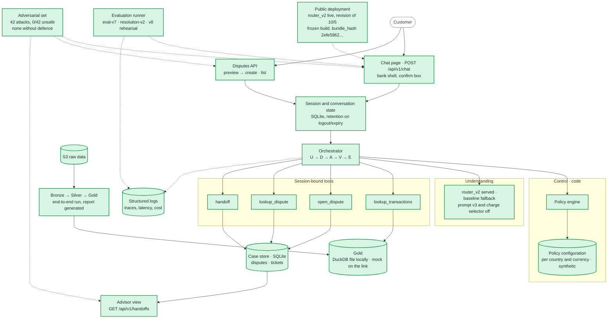

# Component status

This page is the record of the first phase. It is not the current plan. The index is in [the team record](README.md).

This page shows where the build stands on Mon 10/5. It uses the same components as the [System Architecture](../docs/architecture/system-architecture.md), painted by status. The evidence for each item is in [tasks](tasks.md) and in the [requirements](../docs/requirements/requirements.md).

Legend: green = implemented and tested. Amber = partial (it works behind a mock, offline only, or not run on real data). Red = missing.

## Reading it

- **Done (20):** the full demo path on one app and one API under `/api/v1`.
  - Chat and the two-step disputes API. Password session with roles. Conversation state in SQLite. The system deletes the state on logout or expiry.
  - The loop and the policy engine with synthetic fraud and high-amount thresholds for each account country and currency ([010](../docs/build/decisions/010-fraud-handoff-rule.md), [011](../docs/build/decisions/011-high-amount-threshold.md)).
  - The four tools with read-back verification, handoff tickets and the read-only advisor view. The structured log and the free-text masking.
  - The bank interface: bank shell, charge states, the "Mis reclamos" panel, the phone layout and the white label (`bank-ui`).
  - Understanding: `router_v2` is served with a baseline fallback. `2024Q4-eval-v7` measured it. The chat answers greetings, thanks and "are you a bot?". The model writes a draft only on turns that do not decide ([024](../docs/build/decisions/024-model-wording.md), `chat-start`). Code narrows the charge list, answers "why?" and refuses prompt extraction.
  - Gold: the app reads the PII-free view from the DuckDB file locally. The public link uses the labeled mock.
  - The pipeline: the runner generates the quality report (`quality-report`).
  - The evaluation: `2024Q4-eval-v7`, `2024Q4-resolution-v2`, the calibration runs, the trained baseline (`train-v1`), the v8 rehearsal and ablation, and the sealed `2024Q4-eval-v8`. See the [evidence index](../evidence/README.md).
  - The [latest adversarial run](../evidence/adversarial/20261005T014816Z/summary.json): 42 attacks, `0/42` unsafe, none without a defense.
  - Robustness: the health route, the audit chain, the spend cap and the fault injection. The fault-injection run [`20261005T210525Z`](../evidence/robustness/20261005T210525Z/summary.json) and the load run [`20261005T211031Z`](../evidence/robustness/20261005T211031Z/summary.json) measure them.
  - The public deployment: `router_v2` is live. The state is on an Azure Files share. The revision is from 10/5 and serves the frozen build. See [delivery](../docs/build/delivery.md#gate-g3-record).
- **Partial (0).**
- **Off on purpose:** prompt v3 (`SENTINEL_LLM_PROMPT_VERSION=v3`) stays off. The v8 measurement did not approve it. The confidence cut-offs (`SENTINEL_LLM_CUTOFFS`) and the charge selector (`SENTINEL_CHARGE_RANKER`, [025](../docs/build/decisions/025-charge-selector.md)) are also off by default.
- **Missing (0).**

## What unblocks what

The team merged and archived these plans: `dispute-answers`, `resolution-eval`, `chat-loop`, `real-gold`, `runtime-and-ci`, `quality-report`, `ui-product`, `evaluation-final`, `flow-fixes`, `router-v3`, `bank-ui`, `chat-start`, `problem-evidence`, `trained-baseline`, `charge-ranker` and `robustness-evidence`.

Every plan is in `openspec/changes/archive/`. The code is frozen. The recording of the video and the tags are the remaining work.
